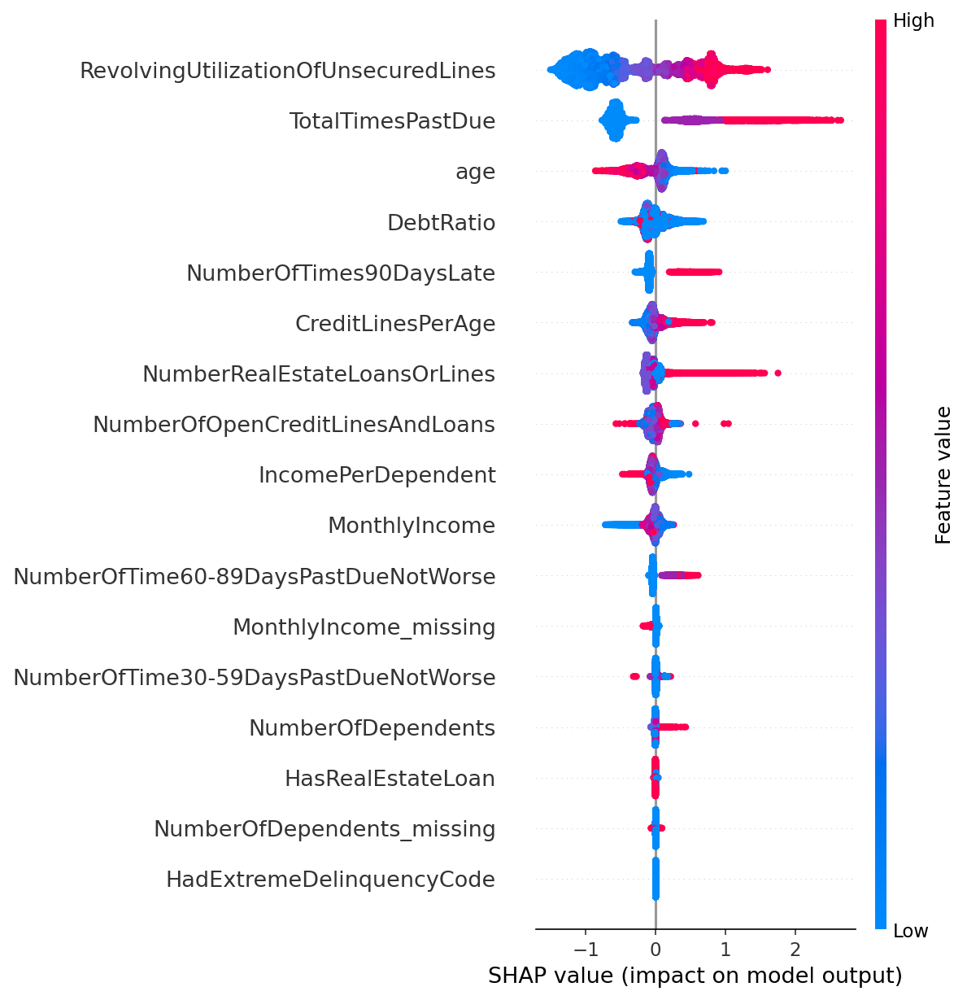

# Credit Risk: Loan Default Prediction

A machine learning project that predicts whether a borrower will become seriously delinquent (90+ days past due) within two years, using the Kaggle [Give Me Some Credit](https://www.kaggle.com/c/GiveMeSomeCredit) dataset. The best model is XGBoost (validation ROC-AUC 0.872), and SHAP is used to explain why the model flags a borrower as risky.

## Why this matters

Banks lose money when they lend to people who do not repay, and lose business when they reject people who would have. A good default model ranks borrowers by risk, and an explainable one lets a loan officer see *why* someone was flagged. That is why this project pairs accuracy with SHAP explainability.

## Results

| Model | Train AUC | Validation AUC |
|---|---|---|
| Logistic Regression (baseline) | 0.851 | 0.859 |
| Decision Tree (unrestricted) | 1.000 | 0.616 |
| Decision Tree (restricted) | 0.855 | 0.858 |
| Random Forest | 0.870 | 0.871 |
| **XGBoost (final)** | 0.880 | **0.872** |

### Final test-set performance (XGBoost, 22,500 borrowers)

**Test ROC-AUC: 0.873**, in line with the validation AUC (0.872), so the model is not overfitting to the validation set.

Confusion matrix at threshold 0.2 (rows = actual, columns = predicted):

| | Predicted OK | Predicted default |
|---|---|---|
| **Actually OK** | 19,779 | 1,217 |
| **Actually defaulted** | 727 | 777 |

| Class | Precision | Recall | F1 |
|---|---|---|---|
| 0 (repaid) | 0.96 | 0.94 | 0.95 |
| 1 (default) | 0.39 | 0.52 | 0.44 |

At this threshold the model catches about half of the real defaulters (recall 0.52). About 4 in 10 borrowers it flags actually default (precision 0.39). Moving the threshold trades one for the other.

### SHAP explainability



Things worth noting:
- The unrestricted decision tree scores about 1.0 on training data but only 0.616 on validation, a clear case of overfitting. It is kept in the code on purpose to show this.
- Hyperparameter search (RandomizedSearchCV) gave a validation AUC of about 0.871, no real gain over the hand-picked settings, so it was dropped.
- The three advanced models are close. XGBoost's gain over logistic regression is small but consistent.

## How it works

```
cs-training.csv
      |
      v
 data_prep.py        split 70/15/15 -> clean -> scale
      |
      +--> train_baseline.py   logistic regression (scaled data)
      +--> train_models.py     tree, random forest, XGBoost -> test evaluation -> saves model
                |
                v
          explain_model.py     SHAP summary + single-borrower waterfall
```

### Key decisions

**1. Fit on training data only.** Medians, outlier caps and scaling statistics are learned from the training set and applied to validation and test. Using the full dataset would leak information from the test set into training.

**2. Stratified split.** Only about 7% of borrowers default. Stratifying keeps that share the same in train, validation and test.

**3. Cleaning steps**
- Rows with age 0 are dropped.
- Missing income and dependents are filled with the training median, and a `_missing` flag column records which rows were filled.
- The delinquency columns contain the special codes 96 and 98, which are not real counts. They are flagged (`HadExtremeDelinquencyCode`) and the counts capped at 20.
- `RevolvingUtilizationOfUnsecuredLines` and `DebtRatio` are capped at the 99th percentile.

**4. Engineered features:** `TotalTimesPastDue`, `CreditLinesPerAge`, `IncomePerDependent`, `HasRealEstateLoan`.

**5. Decision threshold of 0.2, not 0.5.** With only about 7% defaulters, a 0.5 cut-off misses most of them. A lower threshold catches more real defaulters at the cost of more false alarms. In practice the right threshold depends on the cost of a missed default versus a rejected good customer. The value is set in `src/config.py`.

**6. Test set used once.** Models are compared on the validation set. The test set is scored only for the final model.

## Project structure

```
credit-risk-default-prediction/
├── data/
│   ├── raw/              empty on GitHub, put cs-training.csv here
│   └── processed/        empty on GitHub, filled by data_prep.py
├── models/               empty on GitHub, filled by train_models.py
├── reports/figures/      SHAP plots
├── src/
│   ├── config.py         paths, constants, threshold
│   ├── data_prep.py      split, clean, scale
│   ├── train_baseline.py logistic regression
│   ├── train_models.py   tree models + final evaluation
│   └── explain_model.py  SHAP
├── requirements.txt
└── README.md
```

## How to run

```bash
git clone https://github.com/SansKAr1909/credit-risk-default-prediction.git
cd credit-risk-default-prediction
pip install -r requirements.txt
```

1. Download `cs-training.csv` from the [Kaggle competition page](https://www.kaggle.com/c/GiveMeSomeCredit/data) and place it in `data/raw/`.
2. Run the steps in order, from the project root:

```bash
python -m src.data_prep
python -m src.train_baseline
python -m src.train_models
python -m src.explain_model
```

## Tech stack

Python, pandas, scikit-learn, XGBoost, SHAP, matplotlib.

## Possible next steps

- Handle class imbalance explicitly (class weights or SMOTE) and compare.
- Calibrate the predicted probabilities.
- Add a Power BI dashboard for the predictions and risk bands.
